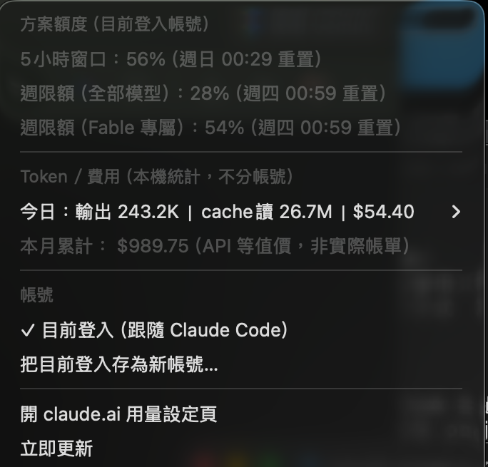

# claude-usage-widget

[English](README.en.md) | 繁體中文

macOS 選單列的 Claude 用量監測 widget（SwiftBar plugin）。

選單列常駐顯示 `CC 30% ⁄49`（5小時窗口% ⁄ Fable 週限%），用量 ≥60% 橘字、≥85% 紅字，≥90% 發系統通知。點開看明細：




> ⚠️ 非 Anthropic 官方專案。詳見[免責聲明](#免責聲明)。

## 顯示內容

**方案額度**（即 Claude Code `/usage` 的數據）
- 5 小時窗口使用率＋重置時間
- 週限額（全部模型）
- 週限額（Fable 專屬）

> 💡 訂閱額度是 claude.ai 網頁、桌面 app、Claude Code **共用**的，所以這些百分比涵蓋你在所有介面的用量，不只 CLI。

**Token／費用**（本機統計，不分帳號）
- 今日輸出 token、cache 讀取量、API 等值費用＋各模型明細
- 本月累計費用（⚠ 為「若走 API 計費」的參考價，不是訂閱實際帳單）

## 多帳號切換

選單最下方「帳號」區：

1. 在 Claude Code 登入帳號 A → 點「**把目前登入存為新帳號…**」取個名字（如 `work`）
2. 在 Claude Code 改登入帳號 B → 再存一次（如 `personal`）
3. 之後點帳號名稱即可切換查詢對象；「目前登入」則永遠跟隨 Claude Code 當下登入的帳號

已存帳號的 token 放在 Keychain 的 `claude-usage-widget:<名稱>` 條目，快過期時會用 refresh token 自動續期，不需重新登入。按住 **⌥（Option）** 點帳號名稱可移除。選中非「目前登入」帳號時，選單列的 `CC` 會換成該帳號名稱。

⚠ Token／費用區塊來自本機紀錄，跟選了哪個帳號無關。

## 用量通知

任一額度（5小時窗口／週限額）**≥90%** 時發 macOS 系統通知。同一個重置窗口只提醒一次（以 `resets_at` 判斷），重置後才會再提醒。門檻改 `NOTIFY_AT` 常數。

## 安全與隱私

這個 widget 會讀取你本機 Keychain 裡 **Claude Code 的 OAuth token**（`Claude Code-credentials` 條目），你應該知道也有權知道它拿去做什麼：

- **讀取需要你明確同意**：macOS Keychain 有存取控制，widget 第一次讀取時系統會跳授權視窗，你不點「允許」它就讀不到
- **token 只送往 `api.anthropic.com`**（Anthropic 官方 API），用來查你自己的用量；不落地成檔案、不送往任何第三方
- **多帳號功能**會把 token 複製到 widget 自己的 Keychain 條目（`claude-usage-widget:<名稱>`），同樣存在 Keychain、不寫進一般檔案
- **程式碼就一個 Python 檔**（[claude-usage.5m.py](claude-usage.5m.py)，約 250 行），無任何第三方套件，歡迎自行審閱
- Token／費用統計由 [ccusage](https://github.com/ryoppippi/ccusage) 在本機解析 `~/.claude/projects/**/*.jsonl`，全程離線

## 免責聲明

- 本專案**與 Anthropic 無關**，非官方工具
- 方案額度使用的 `api.anthropic.com/api/oauth/usage` 與 token 續期介面**皆非公開文件的 API**，Anthropic 可能隨時變更而使本工具失效
- 費用數字為 API 牌價換算的參考值（美元），**不是**你的實際帳單

## 架構

```
claude-usage.5m.py   ← plugin 本體（檔名的 5m = 每 5 分鐘刷新）
```

兩個資料來源：
1. **方案額度**：從 macOS Keychain 讀 Claude Code 的 OAuth token，打官方 `api.anthropic.com/api/oauth/usage`
2. **Token／費用**：ccusage 解析本機紀錄

## 安裝

```bash
./install.sh
```

腳本會：裝 SwiftBar（brew cask）、Node.js 與 ccusage（若缺）→ 設定 SwiftBar plugin 目錄為 `~/.swiftbar` → 把 plugin symlink 進去 → 啟動 SwiftBar。

首次執行 macOS 會問 Keychain 存取權 → 點「永久允許」。install.sh 會自動把 SwiftBar 加入登入項目，重開機／登出後選單列圖示會自動出現；若被手動移除，可到「系統設定 > 一般 > 登入項目」重新加回。

> 💡 選單列圖示太多時，macOS 會**默默隱藏**放不下的項目。看不到 widget 的話，先按住 ⌘ 拖掉幾個不用的圖示。

## 更新

```bash
git pull
```

plugin 是 symlink 進 SwiftBar 的，拉完下次刷新自動生效，不用重裝。

## 移除

```bash
./uninstall.sh
```

會移除 plugin、設定檔與 widget 自存的 Keychain 帳號條目；**不會**動到 Claude Code 本身的憑證，也不會移除 SwiftBar／ccusage（腳本會告訴你怎麼手動移除）。

## 自訂

- 刷新頻率：改檔名（`5m`→`1m`、`30s`…），symlink 要重建
- 變色門檻：改 `color_for()` 的 85／60
- 通知門檻：改 `NOTIFY_AT`（預設 90）
- 選單列顯示格式：改檔尾 `# ---- 輸出 ----` 區塊

## Roadmap

- **Übersicht 桌面卡片 widget**：天氣 widget 風格的桌面儀表板，複用同一套資料邏輯，當本專案的第二種顯示模式
- **OAuth 自行登入**：widget 自己走授權流程、不讀 Claude Code 的 Keychain 憑證，也讓沒裝 Claude Code 的使用者可用

## License

[MIT](LICENSE)
